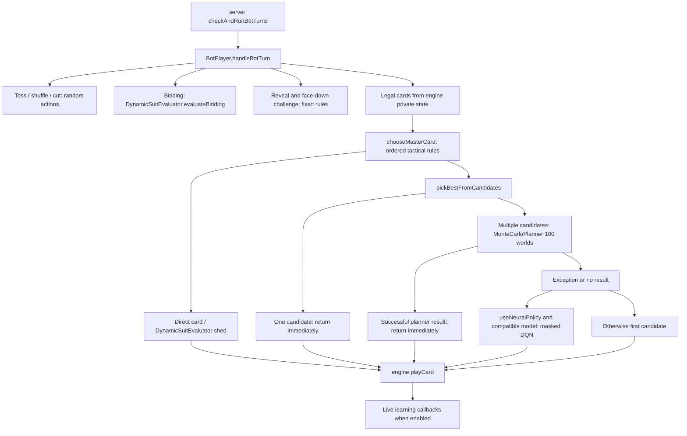

# Bund Rung AI decision architecture

Audited base: `b07dea61c43edb4b5390566361f4bb405c6414c9`, 31 October 2026.
This audit adds tools, documentation and tests; it changes no engine, AI policy,
frontend, Socket.IO event or model weights.

## Live decision path

`server/server.ts` sets `BotPlayer.useNeuralPolicy = true`. This does **not**
make the neural network the main controller: in
`BotPlayer.pickBestFromCandidates`, the unconditional successful planner return
precedes the neural block. The test named “MC success bypasses neural selection”
proves the ordering with spies, including the exception fallback.

`chooseMasterCard` is a large ordered heuristic decision tree. It calculates
boss cards, inferred voids, partner-led suits, caller/team roles, apparent streak
threats and hand/suit strength. Many branches return a card directly, including
much of follow-suit play, low-card conservation, overtakes and trump cutting.
Other branches vet a small candidate set and call `pickBestFromCandidates`.
`DynamicSuitEvaluator` supplies bidding, suit rankings and shedding. The planner
cannot reconsider cards excluded by the tactical tree. One-candidate branches
bypass both planning and neural inference. There is no tree expansion or UCT:
`MonteCarloPlanner` is information-set sampling plus greedy rollout scoring,
not Monte Carlo tree search despite local `Mcts` naming.

`handleBotTurn` requests reveal immediately when permitted against an opponent
caller. Engine permissions only allow opponents to request reveal, so its
caller-team “protect it / reveal against Ace” alternative is unreachable through
normal private-state permissions. Showing trump and accepting face-down
challenges are separate fixed actions, not neural actions. Toss, shuffle, cut,
bidding, reveal, challenge and card selection are therefore distinct controllers.
The server also handles timed phase transitions outside `handleBotTurn`.

## Information boundary and planner

The planner takes public state, the actor's hand, inferred voids and an optional
secret suit. It does not read `engine.hands` or opponent private states. The
caller-only fallback to `(engine as any).trumpSuit` in `chooseMasterCard` reads a
secret that the caller already legitimately knows. However, the purported public
state exposes actual face-down caller card identities; both `CardTracker` and
`StateVectorizer` consume those identities. This is an upstream information leak,
not a hidden-hand lookup in the planner. See INFO-01 in the audit.

Each iteration samples one world and passes that same map to every candidate.
Rollouts copy hand arrays and do not splice live arrays. The focused tests verify
shared worlds and no input mutation. They do not establish safety for arbitrary
future code: card objects are shared references and public snapshots are shallow.

World generation shuffles the unobserved deck and greedily fills other players
up to public hand counts. On deadlock it explicitly relaxes voids. It ignores
known owner cards, shown hands and the `secretTrumpSuit` argument. The caller's
locked card can be missing from the supplied `myHand`, even though public hand
counts include it. Rollouts implement their own incomplete rules and utility;
they do not call the authoritative engine or `ScoringEngine`.

## Neural representation and learner

`StateVectorizer` produces 245 floats: 183 base, 46 tactical, 12 planning/teamwork,
and 4 trump-control features. The 52 actions encode suit/rank, not card-ID
strings. The vector contains the actor's hand, played/current cards, position,
revealed trump, inferred voids and derived tactical signals. It does not contain
opponent hands. It mixes absolute player positions in void features with relative
team features, and does not encode the full scoring/modifier context. Locked
trump is excluded from the hand feature until playable; some final caller-trump
features consider only `myHand`, so a locked trump Ace is omitted there too.

`NeuralNetwork` has two shared layers, layer normalization, leaky ReLU, value and
advantage streams and `Q = V + A - mean(A)`. `selectAction` masks selection to the
provided indices and supports epsilon exploration. `ReinforcementLearner` uses
one-step target-network max-Q updates, a replay ring, batch size 32, gamma .95,
learning rate .001 and soft target update .05. This is ordinary target-network
DQN, not Double DQN (no online argmax followed by target evaluation).

`ReplayBuffer` evicts in a ring and samples uniformly **with replacement**, up to
min(batch size, size). It stores references; callers must treat transition arrays
as immutable. This is internally consistent, but has no validation or prioritized
sampling. The current trained JSON has input size 245 and output size 52. Fresh
`NeuralNetwork()` and `ReinforcementLearner()` instead default to 241 inputs.
`ModelManager` checks input size, caches by mtime, and returns the cached model on
some read errors. It does not validate every tensor/finite value. Saves replace
the tracked JSON synchronously, without atomic rename, schema/version metadata,
checkpoint selection or benchmark promotion gating.

## Production versus training

| Path | Behavior controller | Data / writes |
| --- | --- | --- |
| Live bot | Tactical rules, then MC; DQN only on MC fallback | Before/after card hooks when neural flag enabled; learner saves on match over |
| Live human | Socket event's engine-validated action | Server wraps play with the same learning hooks, with actual room ID |
| `train_ai.ts` exploration | Uniform random legal action with epsilon | Per-player transitions, shaped rewards, replay and checkpoint writes |
| `train_ai.ts` exploitation | `chooseMasterCard` (rules + MC) | Learner's online model only chooses if heuristic result maps outside legal mask |
| `train_expert_imitation.ts` | `chooseMasterCard` teacher (rules + MC) | Fresh explicit 245-input network trained to imitate teacher; predictions do not control actions |
| Benchmark `production` | Existing `chooseMasterCard`, MC and neural fallback enabled | No hooks, learning or writes |
| Benchmark `heuristic` | Same tactical rules, first vetted candidate instead of MC/DQN | Scoped synchronous adapter only in CLI/tests |
| Benchmark `neural` | Existing persisted DQN directly selects among engine-legal cards | Diagnostic ablation, not the current production pipeline |

Both trainer processes leave the static neural flag at its default false.
The self-play learner is not installed into `ModelManager` for ongoing action
selection. Its epsilon therefore means random-versus-teacher, not
random-versus-current-learner. Setup and reveal logic also differs from the live
server: trainer loops act on current player, which can differ from the caller
who must show a pending trump, and they do not cover every timed/challenge path.
Neither training script is a reliable benchmark or a model-promotion gate.
